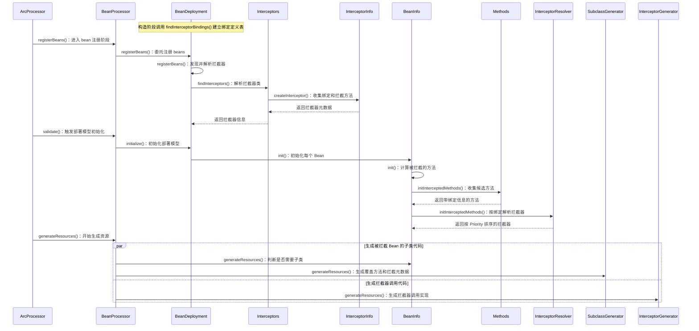
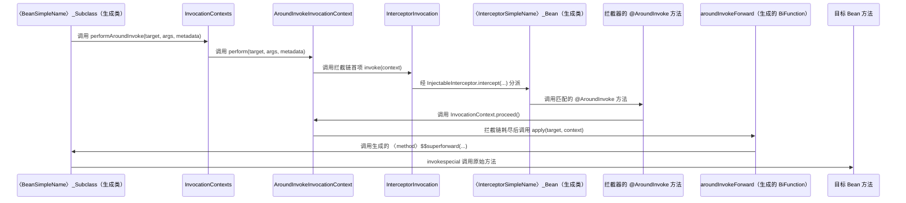

# ArC AOP 拦截流程

## 编译期
> 核心就是生成代理类的时候

| 节点 | 源码入口 | 主要职责 |
|---|---|---|
| ArcProcessor | `io.quarkus.arc.deployment.ArcProcessor#registerBeans()`、`io.quarkus.arc.deployment.ArcProcessor#validate()`、`io.quarkus.arc.deployment.ArcProcessor#generateResources()` | 触发 bean 注册、部署模型初始化和资源生成 |
| BeanProcessor | `io.quarkus.arc.processor.BeanProcessor#registerBeans()`、`io.quarkus.arc.processor.BeanProcessor#initialize()`、`io.quarkus.arc.processor.BeanProcessor#generateResources()` | 驱动部署模型处理和代码生成 |
| BeanDeployment | `io.quarkus.arc.processor.BeanDeployment#findInterceptorBindings()`、`io.quarkus.arc.processor.BeanDeployment#registerBeans()`、`io.quarkus.arc.processor.BeanDeployment#findInterceptors()`、`io.quarkus.arc.processor.BeanDeployment#init()` | 发现绑定与拦截器，初始化部署元数据 |
| Interceptors | `io.quarkus.arc.processor.Interceptors#createInterceptor()` | 从拦截器类提取绑定和拦截方法 |
| InterceptorInfo | `io.quarkus.arc.processor.InterceptorInfo#getBindings()`、`io.quarkus.arc.processor.InterceptorInfo#getAroundInvokes()`、`io.quarkus.arc.processor.InterceptorInfo#intercepts()` | 保存并提供拦截器元数据 |
| BeanInfo | `io.quarkus.arc.processor.BeanInfo#init()`、`io.quarkus.arc.processor.BeanInfo#initInterceptedMethods()`、`io.quarkus.arc.processor.BeanInfo#isSubclassRequired()` | 解析 Bean 方法的拦截器并判断是否需要子类 |
| Methods | `io.quarkus.arc.processor.Methods#addInterceptedMethodCandidates()` | 收集类级和方法级绑定，形成候选方法 |
| InterceptorResolver | `io.quarkus.arc.processor.InterceptorResolver#resolve()` | 按绑定筛选并排序拦截器 |
| SubclassGenerator | `io.quarkus.arc.processor.SubclassGenerator#generate()`、`io.quarkus.arc.processor.SubclassGenerator#generateInitMetadata()` | 生成 Bean 子类代码、拦截元数据和目标方法转发代码 |
| InterceptorGenerator | `io.quarkus.arc.processor.InterceptorGenerator#generate()`、`io.quarkus.arc.processor.InterceptorGenerator#generateIntercept()` | 生成 `InjectableInterceptor` 实现代码 |

## 执行期

| 节点 | 源码入口 | 主要职责 |
|---|---|---|
| `〈BeanSimpleName〉_Subclass`（生成类） | 生成入口：`io.quarkus.arc.processor.SubclassGenerator#createSubclass()`；拦截方法生成：`io.quarkus.arc.processor.SubclassGenerator#createInterceptedMethod()` | 覆盖被拦截的方法，并调用 `InvocationContexts.performAroundInvoke()` |
| `InvocationContexts` | `io.quarkus.arc.impl.InvocationContexts#performAroundInvoke()` | 将调用转交给 AroundInvoke 调用上下文 |
| `AroundInvokeInvocationContext` | `io.quarkus.arc.impl.AroundInvokeInvocationContext#perform()`、`#proceed()` | 执行拦截链；`proceed()` 继续下一个拦截器，或在链结束时调用目标转发函数 |
| `InterceptorInvocation` | `io.quarkus.arc.impl.InterceptorInvocation#invoke()` | 调用拦截器实例的 `intercept()` |
| `〈InterceptorSimpleName〉_Bean`（生成类） | 生成入口：`io.quarkus.arc.processor.InterceptorGenerator#generate()`；分派生成：`io.quarkus.arc.processor.InterceptorGenerator#generateIntercept()` | 实现 Arc 的 `InjectableInterceptor`，把 `intercept()` 调用分派到对应拦截方法 |
| 拦截器的 `@AroundInvoke` 方法 | Quarkus 没有对应的具体方法；生成分派的入口：`io.quarkus.arc.processor.InterceptorGenerator#invokeInterceptorMethod()` | 应用提供的切面逻辑；可选择调用 `InvocationContext.proceed()` |
| `aroundInvokeForward`（生成的 `BiFunction`） | `io.quarkus.arc.processor.SubclassGenerator#generateInitMetadata()` | 作为拦截元数据中的终止转发函数，调用子类生成的 `$$superforward` 方法 |
| 目标 Bean 方法 | Quarkus 没有对应的具体方法；转发方法生成入口：`io.quarkus.arc.processor.SubclassGenerator#createForwardingMethod()` | 被拦截的原始业务方法 |
